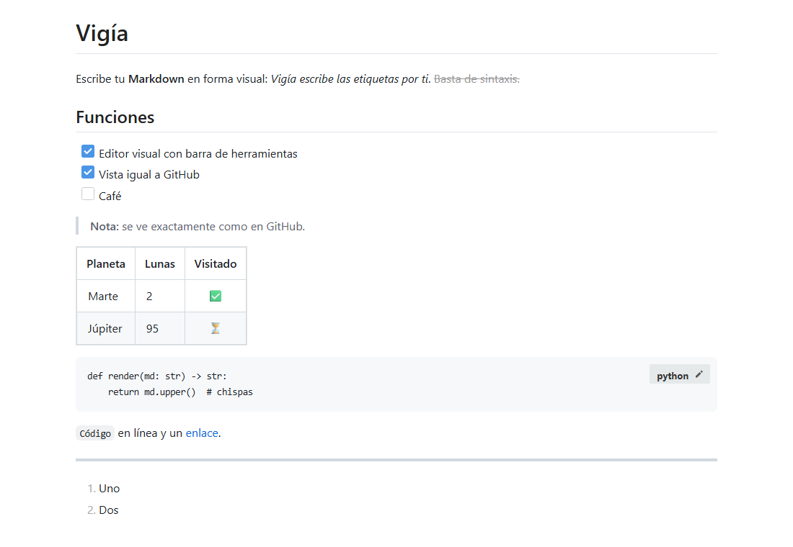

<p align="center"></p>

<h1 align="center">Vigía</h1>
<p align="center"><b>Escribe Markdown en forma visual. Míralo como en GitHub.</b></p>

<p align="center"><a href="README.md">English</a> · <b>Español</b> · <a href="README.ja.md">日本語</a></p>

<p align="center"></p>

<p align="center">Gabriel Castiglia · versión 3.6.0 · GPL-2.0-only</p>

> **Solo para Windows 10/11 en x64 (Intel o AMD de 64 bits).** No hay versión para procesadores ARM.

Vigía es un visor y editor de Markdown para Windows. Das formato con botones —títulos, negrita, listas, tablas,
código— y Vigía escribe las etiquetas de Markdown por ti. Los documentos se ven exactamente como en GitHub, con
tema claro u oscuro. Un *vigía* es quien hace guardia desde la torre. Hasta la versión 1.1.1 se llamaba Quillforge, y
hasta la 2.2.1, Gryphmark.

**Recarga en vivo.** Cuando otro programa cambia el archivo abierto, Vigía muestra el texto nuevo enseguida, no te
mueve de donde estabas leyendo y marca en verde unos segundos lo que cambió. También sigue a las herramientas que
guardan escribiendo un archivo nuevo y renombrándolo encima del viejo.

- **Descarga:** el instalador está en [Releases](https://github.com/Gabriel-Castiglia/vigia-windows/releases/latest).
- **Manual de usuario (PDF):** [`docs/Vigia_Manual_ES.pdf`](docs/Vigia_Manual_ES.pdf) · cambios: [`CHANGELOG.es.md`](CHANGELOG.es.md)
- **Versión para macOS:** <https://github.com/Gabriel-Castiglia/vigia> (solo Apple silicon).

## Requisitos e instalación

- Windows 10 u 11 de 64 bits, con procesador Intel o AMD.
- Microsoft Edge WebView2 Runtime: viene con Windows 11 y con un Windows 10 actualizado. Si Vigía avisa que falta,
  instálalo desde <https://go.microsoft.com/fwlink/p/?LinkId=2124703>.
- Nada más: el runtime de .NET va incluido.

Ejecuta `Vigia-Setup-3.6.0.exe`. El instalador está en inglés, español y japonés, **no** pide permisos de
administrador (instala para el usuario actual en `%LOCALAPPDATA%\Programs\Vigia`) y ofrece un acceso directo en el
escritorio, abrir los archivos `.md` con Vigía y *Abrir con Vigía* en el clic derecho de las carpetas del Explorador.
Si está instalado Quillforge o Gryphmark, lo quita y la configuración se copia sola. Para desinstalar:
*Configuración → Aplicaciones → Aplicaciones instaladas → Vigía*; la configuración en `%APPDATA%\Vigia` se conserva.

## Funciones

- Editor visual, código Markdown con vista previa en vivo y vista GitHub de solo lectura (`Ctrl+1/2/3`)
- Interfaz en inglés, español y japonés, se cambia sin reiniciar
- **Pestañas**: varios documentos en una ventana, cada uno con su propio deshacer y su posición (`Ctrl+N` pestaña nueva, `Ctrl+W` cierra una, `Ctrl+Tab` / `Ctrl+AvPág` cambian, `Ctrl+Mayús+T` reabre la última cerrada; se mueven arrastrándolas y el clic del medio las cierra). Un clic en el panel de archivos abre una pestaña de vista previa, de paso, que el próximo clic reutiliza. Cerrar la ventana las cierra todas; con *Archivo → Reabrir las pestañas al iniciar*, el próximo arranque vuelve a abrir los mismos archivos
- Imágenes y enlaces relativos, también en otras carpetas (`../`); los enlaces a `.md` se abren en Vigía
- Imágenes con ruta absoluta o dirección `file:`, con espacios en la ruta, como `![[imagen.png|300]]` (Obsidian, se buscan en las carpetas abiertas) o ``; una que falta muestra su nombre en un recuadro punteado, y un clic la abre en su visor
- Las tablas entran en la columna: una ruta o un código largo dentro de una celda se corta donde hace falta, en vez de mandar la tabla detrás de una barra de desplazamiento
- Avisos de GitHub, diagramas Mermaid, fórmulas, notas al pie y emojis
- **Panel de archivos**: abres una carpeta entera y recorres sus archivos Markdown en un árbol al costado del documento, como en VS Code u Obsidian (`Ctrl+Mayús+E`); varias carpetas a la vez, cada una con su color, fijado, orden y qué se abre al iniciar. Un solo botón contrae todas las carpetas, o las expande todas cuando está todo cerrado
- **Índice** de los títulos (`Ctrl+Mayús+O`): una barra lateral con los archivos arriba y el índice abajo, como en la Mac (se arrastran su borde y la línea entre los dos)
- **Disposición**: los archivos y el índice van a cualquiera de los dos lados del texto, uno arriba del otro o lado a lado; se elige con los dibujos del botón de disposición de la barra (o *Ver → Disposición*), o arrastrando un panel de su título hasta un costado de la ventana. *Ver → Ancho del texto* ensancha la columna hasta toda la ventana
- **Solo lectura**: el selector *Editar | Solo lectura* de la barra bloquea el texto para que nada cambie por error (`Ctrl+Mayús+L`)
- **Temas**: claro, oscuro o automático (sigue a Windows), y un catálogo de doce colores que cambia el ícono en todo Windows y el resaltado de la app (*Ver → Tema…*); celeste por defecto
- **Instancias dedicadas**: abrir un archivo o una carpeta en su propio Vigía, separado de la ventana principal (`--profile "Nombre"`, o clic derecho en el panel de archivos → acceso directo en el escritorio)
- **Barra de zoom** en la barra de estado (también `Ctrl` + rueda del mouse); con la ventana angosta, los botones que no entran van a un menú ⋯
- Buscar y reemplazar (`Ctrl+F`, `Ctrl+H`); corrector ortográfico en inglés, español (también el del Uruguay, con el voseo) y japonés a la vez (textos con idiomas mezclados), con sugerencias, *Omitir* y *Agregar al diccionario*, y cualquier otro diccionario Hunspell
- **Favoritos**: una estrella en cada archivo o carpeta lo suma a una sola lista para todas las carpetas abiertas, arriba del panel de archivos (se reordena arrastrando, o con clic derecho → subir / bajar); debajo, un bloque RECIENTES opcional
- **Buscar en las carpetas** (`Ctrl+Mayús+F`): todos los archivos Markdown de las carpetas abiertas, resultados por archivo y línea, un clic abre el archivo en la coincidencia; un panel que se ubica como los otros
- **Nuevo archivo Markdown** y **Nueva carpeta**: los dos primeros botones de la barra (o clic derecho sobre una carpeta) los crean en el disco en el acto, en la carpeta seleccionada en el árbol, o en `Documentos\Vigia` si no hay nada seleccionado, y los muestran ahí; el archivo nuevo se abre enseguida. Los dos necesitan el árbol desbloqueado (el candado de arriba del panel de archivos)
- **Eliminar** archivos y carpetas desde el panel de archivos (clic derecho o `Supr`, con el árbol desbloqueado): a la Papelera de reciclaje, después de una pregunta que se puede callar por el resto de esa ventana; una carpeta de red o una memoria USB no tienen Papelera, así que ahí la pregunta, que se hace siempre, avisa que es del todo
- Cambiar nombre y mover archivos y carpetas desde el panel de archivos (`F2`, o arrastrándolos con el candado abierto), con deshacer y rehacer; el documento abierto sigue a su archivo
- Propiedades al principio de un archivo (front matter) como un recuadro plegado y como una tabla, guardadas tal como estaban
- **Convertir a TXT**: clic derecho en un archivo del panel de archivos; se escribe un .txt al lado, como se lee el documento en la vista GitHub, y el archivo Markdown no cambia
- **Autoguardado**, activado de entrada: un archivo con nombre se guarda solo un momento después de que dejas de escribir; el interruptor *Autoguardado* de la barra (también *Archivo → Autoguardado*) lo apaga. Nunca escribe encima de un cambio hecho por otro programa
- Respeta tu formato: al guardar solo cambia lo que editaste, hasta la parte de la línea que tocaste (conserva CRLF/BOM)
- **Enlaces `[[nombre]]`** en la vista GitHub: abren el archivo Markdown de ese nombre en las carpetas abiertas, como en una wiki (uno que falta se ve en rojo), como en la Mac
- Los enlaces de un documento solo abren páginas web, correo, otros archivos Markdown, imágenes y PDF; un enlace a cualquier otro archivo lo muestra en el Explorador en vez de ejecutarlo
- Recuperación ante cierres, instancia única y **actualizaciones que se instalan solas** (la versión publicada tiene que traer la firma del autor y coincidir con sus sumas SHA-256; las ventanas abiertas se vuelven a abrir al terminar)
- Exportar a HTML autónomo (las imágenes locales del documento van dentro de la página), imprimir o guardar como PDF
- Instalador por usuario en inglés, español o japonés (sin permisos de administrador), asociación opcional de `.md`

## Solución de problemas

El manual tiene una sección completa de *Solución de problemas*. Los casos más comunes:

| Qué pasa | Qué hacer |
|---|---|
| Al iniciar: *Hace falta Microsoft Edge WebView2 Runtime* | Instala el runtime desde el enlace de arriba y vuelve a abrir Vigía. |
| Los botones de formato están en gris | Funcionan en las vistas Visual y Markdown con *Editar* elegido (`Ctrl+1`, `Ctrl+Mayús+L`). |
| *Nuevo archivo Markdown*, *Nueva carpeta* o *Eliminar* están en gris | Desbloquea el árbol: el candado de arriba del panel de archivos. |
| Vigía se cerró de golpe | Ábrelo de nuevo: ofrece recuperar cada documento sin guardar. Los errores quedan en `error.log`, en `%APPDATA%\Vigia`. |
| No se ve una imagen de otra computadora | Solo se ve si su carpeta es la del documento o una abierta en el panel de archivos. |

## Compilar

En Windows x64: SDK de .NET 10 o posterior, Node.js con npm, Inno Setup 6 y un navegador Chromium (Edge, Chrome o
Brave) para imprimir los manuales. La versión se escribe solo en `<Version>` de `src/Vigia/Vigia.csproj`.

```powershell
powershell -ExecutionPolicy Bypass -File build.ps1
# -> out/Vigia-Setup-<versión>.exe
```

`-SkipNpm` deja como está el paquete web de `src/Vigia/wwwroot/lib`. `-Art` vuelve a dibujar las imágenes del
instalador a partir de los íconos que ya están en el repositorio; necesita Python 3 con Pillow. Las versiones con que
se compiló la versión publicada están abajo, en *Herramientas de compilación*.

La firma del código es opcional: define `GM_SIGN_THUMBPRINT` con la huella de un certificado del almacén personal
(`Cert:\CurrentUser\My`), o `GM_SIGN_PFX` y `GM_SIGN_PASS` para un archivo `.pfx`. La contraseña nunca va en la línea
de comandos de signtool: el `.pfx` se pone en el almacén personal solo mientras se firma.

### Repositorio

| Ruta | Contenido |
|---|---|
| `src/Vigia/` | Aplicación WPF + WebView2 (C#) y la página del editor en `wwwroot/` |
| `_npm/` | Dependencias web y punto de entrada de esbuild (`entry.js`) |
| `installer/` | Script de Inno Setup e imágenes del asistente |
| `tools/` | Generadores de las imágenes del asistente y de los manuales; `jstest.py`, una prueba sin ventana de la página del editor |
| `docs/` | Manuales (HTML + PDF, EN/ES/JA) y capturas |
| `out/` | Resultado de la compilación: carpeta publicada e instalador |

### Herramientas de compilación

Vigía 3.6.0 se compiló y probó con:

| Herramienta | Versión |
|---|---|
| Windows 11 Pro | x64 |
| SDK / runtime de .NET (autónomo, net10.0-windows) | 10.0.404 / 10.0.15 |
| Microsoft.Web.WebView2 (NuGet) | 1.0.4370.26 |
| WeCantSpell.Hunspell (NuGet) | 7.0.1 |
| Node.js / npm (paquete web, recompilado para la 3.5.4) | 26.12.1 / 11.20.0 |
| esbuild | 0.25.12 |
| Inno Setup | 6.7.3 |
| Google Chrome (PDF de los manuales) | 158.0.8127.89 |
| Python (`-Art`: las imágenes del instalador de la 3.5.3; no se usó para la 3.6.0) | 3.13.17, Pillow 12.3.0 |

Bibliotecas web (versiones exactas en `_npm/package-lock.json`): TOAST UI Editor 3.2.3, marked 18.3.0, KaTeX 0.19.1,
Mermaid 12.3.0, highlight.js 11.12.0, jsdiff 9.0.0, DOMPurify 3.5.0, github-markdown-css 5.9.0, gemoji 8.1.0.

## Licencia

Copyright (C) 2026 Gabriel Castiglia.

Vigía es software libre: puedes redistribuirlo y/o modificarlo bajo los términos de la GNU General Public License,
versión 2 únicamente (GPL-2.0-only), publicada por la Free Software Foundation. Se distribuye SIN NINGUNA GARANTÍA.
El texto completo está en [`LICENSE`](LICENSE).

## Créditos

| Componente | Licencia |
|---|---|
| TOAST UI Editor, ProseMirror, marked (+ extensiones alert, footnote, katex), github-markdown-css, Mermaid, KaTeX, gemoji | MIT |
| highlight.js, jsdiff | BSD-3-Clause |
| DOMPurify | MPL-2.0 (se usa con la opción MPL-2.0 de su doble licencia MPL-2.0 / Apache-2.0) |
| .NET 10 / WPF | MIT |
| WeCantSpell.Hunspell (corrector ortográfico) | MIT |
| Diccionario de inglés (`dict/en.*`, SCOWL / Hunspell en_US 2020.12.07 con la corrección de apóstrofos de LibreOffice de 2024) | Tipo MIT / BSD, ver `dict/LICENSE-en.txt` |
| Diccionarios de español (`dict/es.*`, `dict/es-UY.*`, RLA-ES 2.9) | GPL-3.0+ / LGPL-3.0+ / MPL-1.1+, ver `dict/LICENSE-es.txt` |
| Microsoft Edge WebView2 SDK | Licencia del SDK de WebView2 de Microsoft (redistribuible); el WebView2 Runtime es un componente de Windows |
| Ícono: un faro dibujado para Vigía (2026), un dibujo plano color crema con contorno negro sobre el color del tema | GPL-2.0-only, como el resto |
