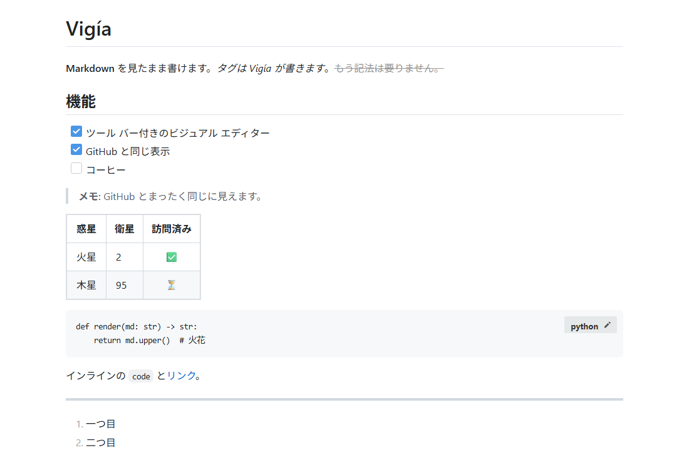

<p align="center"></p>

<h1 align="center">Vigía</h1>
<p align="center"><b>Markdown を見たまま書いて、GitHub と同じ見た目で読む。</b></p>

<p align="center"><a href="README.md">English</a> · <a href="README.es.md">Español</a> · <b>日本語</b></p>

<p align="center"></p>

<p align="center">Gabriel Castiglia · バージョン 3.6.0 · GPL-2.0-only</p>

> **x64（64 ビットの Intel または AMD）の Windows 10/11 専用です。** ARM プロセッサー版はありません。

Vigía は Windows 用の Markdown ビューアー兼エディターです。見出し、太字、リスト、表、コードなどの書式をボタンで付けると、
Markdown のタグは Vigía が書きます。文書は GitHub とまったく同じように、ライトまたはダークのテーマで表示されます。
*Vigía* はスペイン語で、塔から見張りをする「見張り番」のことです。バージョン 1.1.1 までは Quillforge、2.2.1 までは
Gryphmark という名前でした。

**リアルタイムの再読み込み。** ほかのプログラムが開いているファイルを変更すると、Vigía は新しいテキストをすぐに表示し、
読んでいた位置はそのままで、変わった部分を数秒間緑色で示します。新しいファイルに書いてから古いファイルの上に名前を変えて
保存するツールにも追従します。

- **ダウンロード:** インストーラーは [Releases](https://github.com/Gabriel-Castiglia/vigia-windows/releases/latest) にあります。
- **ユーザー マニュアル（PDF）:** [`docs/Vigia_Manual_JA.pdf`](docs/Vigia_Manual_JA.pdf) · 変更履歴: [`CHANGELOG.ja.md`](CHANGELOG.ja.md)
- **macOS 版:** <https://github.com/Gabriel-Castiglia/vigia>（Apple シリコンのみ）。

## 動作環境とインストール

- Windows 10 または 11（64 ビット、Intel または AMD のプロセッサー）。
- Microsoft Edge WebView2 ランタイム: Windows 11 と更新済みの Windows 10 に含まれています。足りないと表示されたら、
  <https://go.microsoft.com/fwlink/p/?LinkId=2124703> からインストールしてください。
- ほかには何も要りません。.NET ランタイムは同梱されています。

`Vigia-Setup-3.6.0.exe` を実行します。インストーラーは英語、スペイン語、日本語に対応し、管理者権限は**不要**です
（現在のユーザー用に `%LOCALAPPDATA%\Programs\Vigia` へインストールします）。デスクトップのアイコン、`.md` ファイルを
Vigía で開く設定、エクスプローラーのフォルダーの右クリックの「Vigía で開く」を選べます。Quillforge や Gryphmark が
インストールされていれば削除し、設定は引き継がれます。アンインストール: *設定 → アプリ → インストールされているアプリ →
Vigía*。`%APPDATA%\Vigia` の設定は残ります。

## 機能

- ビジュアル エディター、リアルタイム プレビュー付きの Markdown ソース、読み取り専用の GitHub プレビュー（`Ctrl+1/2/3`）
- 英語、スペイン語、日本語の画面。再起動せずに切り替えられます
- **タブ**: 1 つのウィンドウで複数の文書を、それぞれ自分の元に戻す履歴とスクロール位置付きで（`Ctrl+N` 新しいタブ、`Ctrl+W` 閉じる、`Ctrl+Tab` / `Ctrl+PageDown` 切り替え、`Ctrl+Shift+T` 最後に閉じたタブを開き直す。ドラッグで移動、中クリックで閉じる）。ファイル パネルでクリックしたファイルは一時的なプレビュー タブに開き、次のクリックで入れ替わります。ウィンドウを閉じるとすべて閉じます。*ファイル → 起動時にタブを復元* をオンにすると、次回の起動時に同じファイルが開きます
- 相対パスの画像とリンク（別のフォルダー `../` も可）。`.md` へのリンクは Vigía で開きます
- 絶対パスや `file:` アドレスの画像（パスに空白があっても可）、`![[picture.png|300]]`（Obsidian 形式。開いているフォルダーから探します）や ``。見つからない画像は名前を点線の枠で示し、クリックでビューアーで開きます
- 表は列に収まります: セル内の長いパスやコードは必要な所で折り返し、表がスクロール バーの陰に隠れません
- GitHub のアラート、Mermaid の図、数式、脚注、絵文字
- **ファイル パネル**: VS Code や Obsidian のように、フォルダーを丸ごと開いてその中の Markdown ファイルを文書の横のツリーでたどれます（`Ctrl+Shift+E`）。複数のフォルダーを同時に開け、それぞれに色、固定、並べ替え、起動時に開くものの設定があります。1 つのボタンですべてのフォルダーを折りたたみ、すべて閉じているときはすべて展開します
- 見出しの**目次**（`Ctrl+Shift+O`）: Mac 版と同じく、上にファイル、下に目次のサイド バー（端と 2 つの間の線をドラッグできます）
- **レイアウト**: ファイルと目次は本文のどちら側にも、上下にも左右にも置けます。ツール バーのレイアウト ボタンの図（または *表示 → レイアウト*）から選ぶか、パネルのタイトルをウィンドウの端までドラッグします。*表示 → 本文の幅* で列をウィンドウ全体まで広げられます
- **読み取り専用**: ツール バーの *編集 | 読み取り専用* で、誤って変更しないようにテキストをロックします（`Ctrl+Shift+L`）
- **テーマ**: ライト、ダーク、自動（Windows に合わせる）と、Windows 全体のアイコンとアプリの強調表示の色を変える 12 色のカタログ（*表示 → テーマ…*）。既定はスカイブルー
- **専用インスタンス**: ファイルやフォルダーを、メイン ウィンドウとは別の専用の Vigía で開けます（`--profile "名前"`、またはファイル パネルで右クリック → デスクトップにショートカット）
- ステータス バーの **ズーム バー**（`Ctrl` + マウス ホイールでも可）。ウィンドウが狭いと、入らないボタンは ⋯ メニューに入ります
- 検索と置換（`Ctrl+F`、`Ctrl+H`）。英語・スペイン語（voseo を含むウルグアイのスペイン語も）・日本語を同時に調べるスペル チェック（複数言語の混在に対応、候補・無視・辞書に追加、ほかの Hunspell 辞書も追加可）
- **お気に入り**: ファイルやフォルダーの行の星で、開いているすべてのフォルダーに共通の一覧に加え、ファイル パネルの先頭に表示します（ドラッグ、または右クリック → 上へ / 下へ移動で並べ替え）。その下に任意の「最近使ったファイル」ブロック
- **フォルダー内を検索**（`Ctrl+Shift+F`）: 開いているフォルダーのすべての Markdown ファイルを検索し、結果はファイルと行ごと。クリックで一致箇所を開きます。ほかと同じように配置できるパネルです
- **新しい Markdown ファイル**と**新しいフォルダー**: ツール バーの最初の 2 つのボタン（またはフォルダーの右クリック）で、ツリーで選んだフォルダー（何も選んでいなければ `ドキュメント\Vigia`）にすぐ作られ、ツリーに表示されます。新しいファイルはすぐに開きます。どちらもツリーのロック解除（ファイル パネル上部の錠前）が必要です
- ファイル パネルでファイルとフォルダーを**削除**（右クリックまたは `Del`。ツリーのロック解除時のみ）: 確認のあとごみ箱へ移動。確認はそのウィンドウの間だけ止められます。ネットワーク フォルダーや USB メモリにはごみ箱がないため、そこでは完全に削除することを毎回確認します
- ファイル パネルでファイルとフォルダーの名前の変更と移動（`F2`、または錠前を開けてドラッグ）。元に戻す / やり直しができ、開いている文書はファイルに付いていきます
- ファイル先頭のプロパティ（front matter）は折りたたんだ枠と表で表示し、書かれたとおりに保存します
- **TXT に変換**: ファイル パネルでファイルを右クリック。GitHub 表示での見え方どおりの .txt を隣に書き出し、Markdown ファイルは変えません
- **自動保存**（既定でオン）: 名前のあるファイルは、入力が止まって少しすると自動で保存されます。ツール バーの *自動保存* スイッチ（*ファイル → 自動保存* でも可）でオフにできます。ほかのプログラムが加えた変更を上書きすることはありません
- 書式はそのまま: 保存で変わるのは編集した部分だけで、触れた行の一部分までに限られます（CRLF/BOM も維持）
- GitHub 表示の **[[名前]] リンク** は、wiki のように、開いているフォルダーにあるその名前の Markdown ファイルを開きます（見つからないものは赤）。Mac 版と同じです
- 文書内のリンクで開くのは Web ページ、メール、ほかの Markdown ファイル、画像、PDF だけです。それ以外のファイルへのリンクは、実行せずにエクスプローラーで表示します
- 異常終了からの復元、単一インスタンス、**自動でインストールされる更新**（公開版には作者の署名が必要で、SHA-256 のチェックサムと照合します。終わると開いていたウィンドウをすべて開き直します）
- 自己完結した HTML へのエクスポート（文書のローカル画像もページに埋め込まれます）、印刷 / PDF として保存
- 英語、スペイン語、日本語のユーザーごとのインストーラー（管理者権限は不要）、`.md` の関連付けは任意

## トラブルシューティング

マニュアルに「トラブルシューティング」の章があります。よくある例:

| 症状 | 対処 |
|---|---|
| 起動時に「Microsoft Edge WebView2 ランタイムが必要です」 | 上のリンクからランタイムをインストールし、Vigía を起動し直します。 |
| 書式のボタンが灰色 | ビジュアルと Markdown の表示で、*編集* を選んでいるときに使えます（`Ctrl+1`、`Ctrl+Shift+L`）。 |
| *新しい Markdown ファイル*、*新しいフォルダー*、*削除* が灰色 | ツリーのロックを解除します（ファイル パネル上部の錠前）。 |
| Vigía が突然終了した | もう一度起動すると、保存していない文書ごとに復元を提案します。エラーは `%APPDATA%\Vigia` の `error.log` に記録されます。 |
| 別のコンピューターの画像が表示されない | そのフォルダーが文書のフォルダーか、ファイル パネルで開いているフォルダーのときだけ表示されます。 |

## ビルド

Windows x64 で: .NET 10 SDK 以降、npm 付きの Node.js、Inno Setup 6、マニュアルを PDF にする Chromium 系ブラウザー
（Edge、Chrome、Brave）。バージョンは `src/Vigia/Vigia.csproj` の `<Version>` だけに書きます。

```powershell
powershell -ExecutionPolicy Bypass -File build.ps1
# -> out/Vigia-Setup-<バージョン>.exe
```

`-SkipNpm` は `src/Vigia/wwwroot/lib` の Web バンドルをそのまま使います。`-Art` はリポジトリにあるアイコンからインストーラーの
画像を描き直し、Pillow 付きの Python 3 が必要です。公開版のビルドに使ったバージョンは下の「ビルド ツール」にあります。

コード署名は任意です。個人用ストア（`Cert:\CurrentUser\My`）にある証明書の拇印を `GM_SIGN_THUMBPRINT` に設定するか、
`.pfx` ファイルなら `GM_SIGN_PFX` と `GM_SIGN_PASS` を設定します。パスワードが signtool のコマンド ラインに渡ることはなく、
`.pfx` は署名している間だけ個人用ストアに置かれます。

### リポジトリ

| パス | 内容 |
|---|---|
| `src/Vigia/` | WPF + WebView2 のアプリ（C#）と `wwwroot/` のエディター ページ |
| `_npm/` | Web の依存関係と esbuild のエントリー（`entry.js`） |
| `installer/` | Inno Setup のスクリプトとウィザードの画像 |
| `tools/` | ウィザードの画像とマニュアルの生成スクリプト。`jstest.py` はエディター ページのヘッドレス テスト |
| `docs/` | マニュアル（HTML + PDF、EN/ES/JA）と画面写真 |
| `out/` | ビルドの出力: 発行フォルダーとインストーラー |

### ビルド ツール

Vigía 3.6.0 のビルドとテストに使ったもの:

| ツール | バージョン |
|---|---|
| Windows 11 Pro | x64 |
| .NET SDK / ランタイム（自己完結型、net10.0-windows） | 10.0.404 / 10.0.15 |
| Microsoft.Web.WebView2 (NuGet) | 1.0.4370.26 |
| WeCantSpell.Hunspell (NuGet) | 7.0.1 |
| Node.js / npm（Web バンドル。3.5.4 用に再ビルド） | 26.12.1 / 11.20.0 |
| esbuild | 0.25.12 |
| Inno Setup | 6.7.3 |
| Google Chrome（マニュアルの PDF） | 158.0.8127.89 |
| Python（`-Art`: 3.5.3 のインストーラーの画像。3.6.0 では未使用） | 3.13.17、Pillow 12.3.0 |

Web ライブラリ（正確なバージョンは `_npm/package-lock.json`）: TOAST UI Editor 3.2.3、marked 18.3.0、KaTeX 0.19.1、
Mermaid 12.3.0、highlight.js 11.12.0、jsdiff 9.0.0、DOMPurify 3.5.0、github-markdown-css 5.9.0、gemoji 8.1.0。

## ライセンス

Copyright (C) 2026 Gabriel Castiglia.

Vigía はフリー ソフトウェアです。Free Software Foundation が公表した GNU 一般公衆利用許諾書 バージョン 2 のみ
（GPL-2.0-only）の条件のもとで再配布や改変ができます。いかなる保証もありません。全文は [`LICENSE`](LICENSE) にあります。

## クレジット

| コンポーネント | ライセンス |
|---|---|
| TOAST UI Editor、ProseMirror、marked（+ alert、footnote、katex 拡張）、github-markdown-css、Mermaid、KaTeX、gemoji | MIT |
| highlight.js、jsdiff | BSD-3-Clause |
| DOMPurify | MPL-2.0（MPL-2.0 / Apache-2.0 のデュアル ライセンスのうち MPL-2.0 で使用） |
| .NET 10 / WPF | MIT |
| WeCantSpell.Hunspell（スペル チェック） | MIT |
| 英語の辞書（`dict/en.*`、SCOWL / Hunspell en_US 2020.12.07、LibreOffice による 2024 年のアポストロフィ修正付き） | MIT 系 / BSD、`dict/LICENSE-en.txt` を参照 |
| スペイン語の辞書（`dict/es.*`、`dict/es-UY.*`、RLA-ES 2.9） | GPL-3.0+ / LGPL-3.0+ / MPL-1.1+、`dict/LICENSE-es.txt` を参照 |
| Microsoft Edge WebView2 SDK | Microsoft WebView2 SDK ライセンス（再頒布可）。WebView2 ランタイムは Windows のシステム コンポーネント |
| アイコン: Vigía のために描いた灯台（2026）。テーマの色の上に黒い輪郭で描いたクリーム色の平面的な絵 | GPL-2.0-only（ほかと同じ） |
