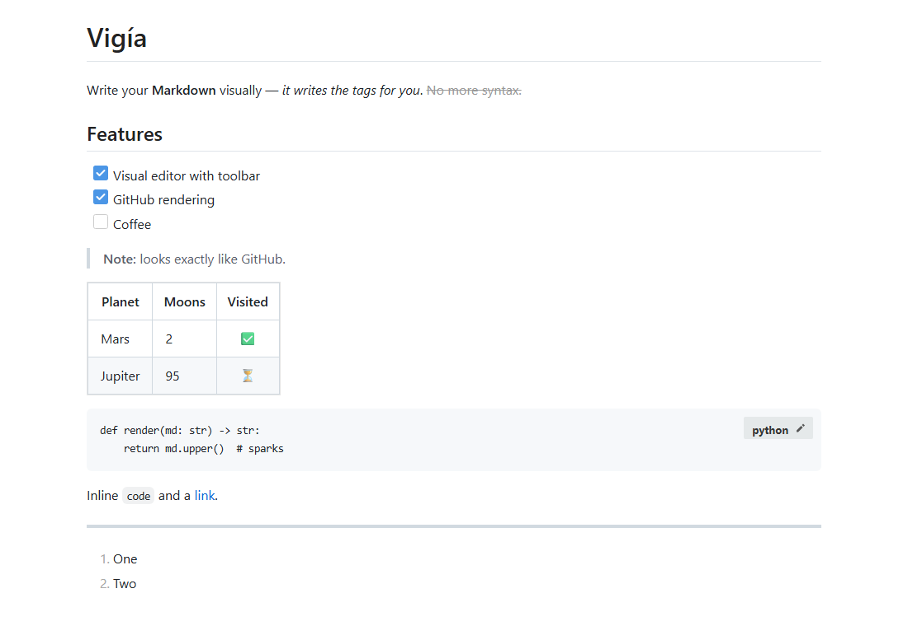

<p align="center"></p>

<h1 align="center">Vigía</h1>
<p align="center"><b>Write Markdown visually. See it like GitHub.</b></p>

<p align="center"><b>English</b> · <a href="README.es.md">Español</a> · <a href="README.ja.md">日本語</a></p>

<p align="center"></p>

<p align="center">Gabriel Castiglia · version 3.6.0 · GPL-2.0-only</p>

> **Windows 10/11 on x64 (64-bit Intel or AMD) only.** There is no build for ARM processors.

Vigía is a Markdown viewer and editor for Windows. Format with buttons — headings, bold, lists, tables, code — and
Vigía writes the Markdown tags for you. Documents are rendered exactly like GitHub, in light or dark theme. *Vigía*
is Spanish for a lookout, the one who keeps watch from the tower. Up to version 1.1.1 it was called Quillforge, and
up to 2.2.1 Gryphmark.

**Live reload.** When another program changes the open file, Vigía shows the new text at once and stays where you
were reading, and marks what changed in green for a few seconds. It also follows tools that save by writing a new
file and renaming it over the old one.

- **Download:** the setup is in [Releases](https://github.com/Gabriel-Castiglia/vigia-windows/releases/latest).
- **User manual (PDF):** [`docs/Vigia_Manual_EN.pdf`](docs/Vigia_Manual_EN.pdf) · changes: [`CHANGELOG.md`](CHANGELOG.md)
- **macOS version:** <https://github.com/Gabriel-Castiglia/vigia> (Apple silicon only).

## Requirements and installation

- Windows 10 or 11, 64-bit, on an Intel or AMD processor.
- Microsoft Edge WebView2 Runtime: part of Windows 11 and of an up-to-date Windows 10. If Vigía says it is missing,
  install it from <https://go.microsoft.com/fwlink/p/?LinkId=2124703>.
- Nothing else: the .NET runtime is included.

Run `Vigia-Setup-3.6.0.exe`. The installer speaks English, Spanish and Japanese, needs **no** administrator rights
(it installs for the current user in `%LOCALAPPDATA%\Programs\Vigia`) and offers a desktop shortcut, opening `.md`
files with Vigía, and *Open with Vigía* in the right-click menu of folders in Explorer. A previous Quillforge or
Gryphmark is removed and its settings are carried over. To uninstall: *Settings → Apps → Installed apps → Vigía*;
your settings in `%APPDATA%\Vigia` are kept.

## Features

- Visual editor, Markdown source with live preview, and read-only GitHub preview (`Ctrl+1/2/3`)
- English, Spanish and Japanese interface, switchable at runtime
- **Tabs**: several documents in one window, each with its own undo history and scroll position (`Ctrl+N` new tab, `Ctrl+W` closes one, `Ctrl+Tab` / `Ctrl+PageDown` switch, `Ctrl+Shift+T` reopens the last one closed; drag a tab to move it, middle-click closes it). A click in the Files panel opens a passing preview tab that the next click reuses. Closing the window closes them all; with *File → Reopen tabs at start* the next start opens the same files again
- Relative images and links, also in other folders (`../`); `.md` links open in Vigía
- Pictures by absolute path or `file:` address, with spaces in the path, as `![[picture.png|300]]` (Obsidian, looked for in the open folders) or ``; a missing one shows its name in a dashed box, a click opens it in its viewer
- Tables fit the column: a long path or piece of code in a cell breaks where it has to instead of pushing the table behind a scrollbar
- GitHub alerts, Mermaid diagrams, math, footnotes and emoji
- **Files panel**: open a whole folder and browse its Markdown files in a tree beside the document, like VS Code or Obsidian (`Ctrl+Shift+E`); several folders at once, each with its own colour, pinning, sorting and a choice of what opens at start. One button collapses every folder, or expands them all when everything is closed
- **Outline** of the headings (`Ctrl+Shift+O`): a sidebar with the files above and the outline below, as on the Mac (drag its edge and the line between them)
- **Layouts**: the files and the outline go on either side of the text, one above the other or side by side; pick one from the drawings behind the layout button of the toolbar (or *View → Layout*), or drag a pane by its title to an edge of the window. *View → Text width* widens the column up to the whole window
- **Read only**: the *Edit | Read only* switch in the toolbar locks the text so nothing changes by mistake (`Ctrl+Shift+L`)
- **Themes**: light, dark or automatic (follows Windows), and a catalogue of twelve colours that changes the icon everywhere in Windows and the highlights of the app (*View → Theme…*); sky blue by default
- **Dedicated instances**: open a file or folder in its own Vigía, separate from the main window (`--profile "Name"`, or right-click in the Files panel → desktop shortcut)
- **Zoom bar** in the status bar (also `Ctrl` + mouse wheel); on a narrow window the buttons that do not fit go into a ⋯ menu
- Find & replace (`Ctrl+F`, `Ctrl+H`); spell check in English, Spanish (also the Spanish of Uruguay, with the voseo) and Japanese at once (mixed-language text), with suggestions, *Ignore* and *Add to dictionary*, and any other Hunspell dictionary
- **Favourites**: a star on each file or folder row puts it in one list for all the open folders, at the top of the Files panel (drag to reorder, or right-click → move up / down); an optional RECENT block below it
- **Search in the folders** (`Ctrl+Shift+F`): every Markdown file of the open folders, results by file and line, a click opens the file at the match; a pane you place like the others
- **New Markdown file** and **New folder**: the first two buttons of the toolbar (or right-click a folder) make them on disk at once, in the folder selected in the tree, or in `Documents\Vigia` with nothing selected, and show them there; a new file opens at once. Both need the tree unlocked (the padlock at the top of the Files panel)
- **Delete** files and folders from the Files panel (right-click or `Del`, with the tree unlocked): to the Recycle Bin, after a question that can be silenced for the rest of that window; a network folder or a USB stick has no Recycle Bin, so there the question, always asked, says it is for good
- Rename and move files and folders from the Files panel (`F2`, or drag them with the padlock open), with undo and redo; the open document follows its file
- Properties at the top of a file (front matter) shown as a folded box and as a table, saved as written
- **Convert to TXT**: right-click a file in the Files panel; a .txt is written next to it, as the document reads in the GitHub view, and the Markdown file is not changed
- **Autosave**, on by default: a file with a name saves itself a moment after you stop typing; the *Autosave* switch in the toolbar (also *File → Autosave*) turns it off. It never writes over a change made by another program
- Keeps your formatting: only what you edit changes on save, down to the part of a line you touched (CRLF/BOM preserved)
- **[[name]] links** in the GitHub view open the Markdown file of that name in the open folders, as in a wiki (a missing one is red), as on the Mac
- Links in a document open only web pages, e-mail, other Markdown files, pictures and PDFs; a link to any other file shows it in Explorer instead of running it
- Crash recovery, single instance, and **updates that install themselves** (the release must carry the author's signature and match its SHA-256 checksums; every open window is reopened afterwards)
- Export to self-contained HTML (the document's local pictures go inside the page), print / save as PDF
- Per-user installer in English, Spanish or Japanese (no admin rights), optional `.md` association

## Troubleshooting

The manual has a full *Troubleshooting* section. The most common cases:

| What happens | What to do |
|---|---|
| *Microsoft Edge WebView2 Runtime is required* at start | Install the runtime from the link above and start Vigía again. |
| The formatting buttons are grey | They work in the Visual and Markdown views with *Edit* chosen (`Ctrl+1`, `Ctrl+Shift+L`). |
| *New Markdown file*, *New folder* or *Delete* are grey | Unlock the tree: the padlock at the top of the Files panel. |
| Vigía closed unexpectedly | Start it again: it offers to recover every unsaved document. Errors go to `error.log` in `%APPDATA%\Vigia`. |
| A picture on another computer does not show | It shows only when its folder is the document's or one open in the Files panel. |

## Build

On Windows x64: .NET 10 SDK or later, Node.js with npm, Inno Setup 6 and a Chromium browser (Edge, Chrome or Brave)
to print the manuals. The version is written only in `<Version>` of `src/Vigia/Vigia.csproj`.

```powershell
powershell -ExecutionPolicy Bypass -File build.ps1
# -> out/Vigia-Setup-<version>.exe
```

`-SkipNpm` keeps the web bundle in `src/Vigia/wwwroot/lib` as it is. `-Art` redraws the installer pictures from the
committed icons; it needs Python 3 with Pillow. The versions used for the released build are listed under
*Build tools* below.

Code signing is optional: set `GM_SIGN_THUMBPRINT` to the thumbprint of a certificate in the personal store
(`Cert:\CurrentUser\My`), or `GM_SIGN_PFX` and `GM_SIGN_PASS` for a `.pfx` file. The password never goes on signtool's
command line: the `.pfx` is put in the personal store only while signing.

### Repository

| Path | Content |
|---|---|
| `src/Vigia/` | WPF + WebView2 app (C#) and `wwwroot/` editor page |
| `_npm/` | Web dependencies and esbuild entry (`entry.js`) |
| `installer/` | Inno Setup script and wizard art |
| `tools/` | Wizard art and manual generators; `jstest.py`, a headless test of the editor page |
| `docs/` | Manuals (HTML + PDF, EN/ES/JA) and screenshots |
| `out/` | Build output: publish folder and installer |

### Build tools

Vigía 3.6.0 was built and tested with:

| Tool | Version |
|---|---|
| Windows 11 Pro | x64 |
| .NET SDK / runtime (self-contained, net10.0-windows) | 10.0.404 / 10.0.15 |
| Microsoft.Web.WebView2 (NuGet) | 1.0.4370.26 |
| WeCantSpell.Hunspell (NuGet) | 7.0.1 |
| Node.js / npm (web bundle, rebuilt for 3.5.4) | 26.12.1 / 11.20.0 |
| esbuild | 0.25.12 |
| Inno Setup | 6.7.3 |
| Google Chrome (manual PDFs) | 158.0.8127.89 |
| Python (`-Art`: the installer pictures of 3.5.3; not used for 3.6.0) | 3.13.17, Pillow 12.3.0 |

Web libraries (exact versions in `_npm/package-lock.json`): TOAST UI Editor 3.2.3, marked 18.3.0, KaTeX 0.19.1,
Mermaid 12.3.0, highlight.js 11.12.0, jsdiff 9.0.0, DOMPurify 3.5.0, github-markdown-css 5.9.0, gemoji 8.1.0.

## License

Copyright (C) 2026 Gabriel Castiglia.

Vigía is free software: you can redistribute it and/or modify it under the terms of the GNU General Public License,
version 2 only (GPL-2.0-only), as published by the Free Software Foundation. It is distributed WITHOUT ANY WARRANTY.
See [`LICENSE`](LICENSE) for the full text.

## Credits

| Component | License |
|---|---|
| TOAST UI Editor, ProseMirror, marked (+ alert, footnote, katex extensions), github-markdown-css, Mermaid, KaTeX, gemoji | MIT |
| highlight.js, jsdiff | BSD-3-Clause |
| DOMPurify | MPL-2.0 (used under the MPL-2.0 option of its MPL-2.0 / Apache-2.0 dual licence) |
| .NET 10 / WPF | MIT |
| WeCantSpell.Hunspell (spell check) | MIT |
| English dictionary (`dict/en.*`, SCOWL / Hunspell en_US 2020.12.07 with LibreOffice's 2024 apostrophe fix) | MIT-like / BSD, see `dict/LICENSE-en.txt` |
| Spanish dictionaries (`dict/es.*`, `dict/es-UY.*`, RLA-ES 2.9) | GPL-3.0+ / LGPL-3.0+ / MPL-1.1+, see `dict/LICENSE-es.txt` |
| Microsoft Edge WebView2 SDK | Microsoft WebView2 SDK license (redistributable); the WebView2 Runtime is a Windows system component |
| Icon: a lighthouse drawn for Vigía (2026), a flat cream drawing with a black outline on the theme colour | GPL-2.0-only, like the rest |
